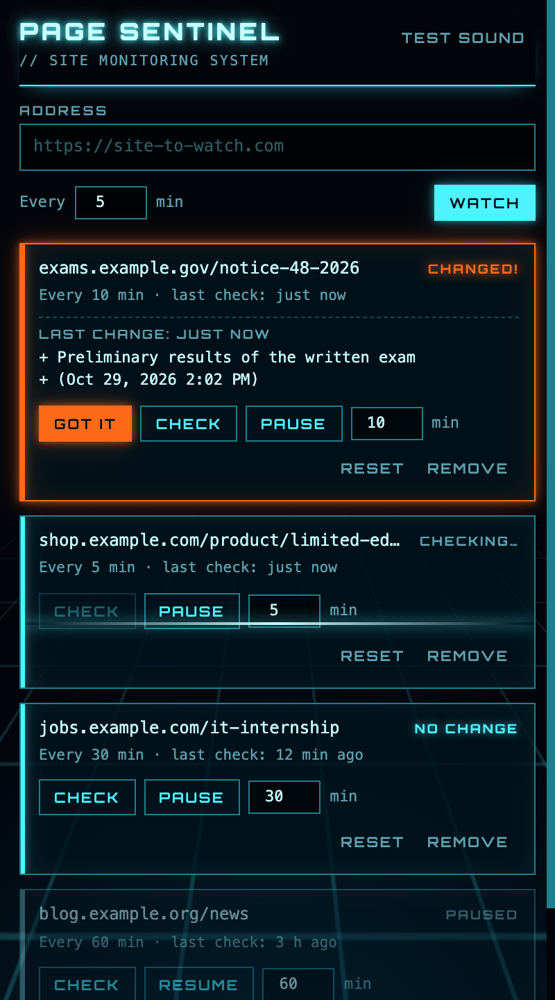

<p align="center">
  
</p>

<h1 align="center">Page Sentinel</h1>

<p align="center">
  <a href="https://github.com/gustavolgcr/page-sentinel/actions/workflows/build.yml"></a>
  <a href="LICENSE"></a>
  <a href="https://developer.chrome.com/docs/extensions/develop/migrate/what-is-mv3"></a>
</p>

<p align="center">
  A simple, free Chrome extension that checks websites on a schedule and <b>plays a sound</b> when their content changes.<br>
  No account, no server, no tabs popping up. Retro 1980s sci-fi look.
</p>

<p align="center">
  
</p>

## Why

Existing page-monitoring extensions tend to do too much or cost money. This one does one thing: it tells you, with a sound, when a page changes. It started as a way to follow a public-exam announcement page without refreshing it all day.

## Features

- Checks each site at the interval you choose (1 minute minimum).
- Works on sites that build their content with JavaScript.
- Never opens tabs while checking.
- Shows which lines were added and removed.
- Confirms every change with a second read before alerting.
- Alerts with a soft retro synth arpeggio, a system notification and a counter on the icon.
- Checks overdue sites right away when the computer wakes up or Chrome starts.
- Everything stays in your browser. No data is sent anywhere.

## Install (from source)

1. Download or clone this repository.
2. Open `chrome://extensions` in Chrome.
3. Turn on **Developer mode** (top right).
4. Click **Load unpacked** and pick the project folder.
5. Pin the icon: click the puzzle piece 🧩 in Chrome's toolbar and the pin next to "Page Sentinel".

After editing any file (or pulling a new version), go back to `chrome://extensions` and click the extension's reload button ↻.

## Usage

1. Click the icon. If you're on the page you want to watch, the address is already filled in.
2. Pick the interval in minutes and click **Watch**.
3. The first check runs right away and becomes the baseline. From then on, every change in the page text:
   - plays a soft retro synth arpeggio;
   - shows a notification (click it to open the site);
   - puts an orange counter on the icon;
   - appears in the popup with the added (+) and removed (−) lines.
4. Click **Got it** to clear the alert.

Other buttons: **Check** (check now), **Pause/Resume**, change the interval right in its field, **Reset** (use the current page as the new baseline) and **Remove**. Use **Test sound** at the top to check the volume.

### Sites for testing

- Always changes (should alert on every check): `https://www.random.org/integers/?num=1&min=1&max=1000&col=1&base=10&format=plain&rnd=new`
- Never changes (should never alert): `https://example.com`

## How it works

- **No tabs:** the page is loaded inside a hidden page that belongs to the extension. The site's JavaScript runs normally, so it also works on single-page apps. For sites that forbid being embedded, the extension lifts that restriction only for its own checks. If that still fails, it falls back to a background tab and the item shows "using a tab".
- **What is compared:** only the page text, including collapsed sections. Layout, script or image changes don't trigger an alert.
- **Sleep or Chrome closed:** sites and baselines are saved. When Chrome opens or the computer is unlocked, every overdue site is checked right away.
- **No false alarms from half-loaded pages:** when a page looks different, it is read again 15 seconds later. The alert only fires if the change is still there, so a slow or failing server doesn't trigger it.
- **Errors** (offline, site down): never count as a change. The extension retries in 1 minute, up to 3 times, then goes back to the normal interval.

## Memory use

Measured on Chrome 156 (macOS), watching a JavaScript-heavy page:

| Moment | Memory |
|---|---|
| Between checks | Nearly zero. The background worker sleeps, and the hidden page is closed 20 s after each check. |
| During a check (a few seconds) | About 100 MB for the site being loaded, the same as opening it in a tab. Released right after. |
| On every page you browse | Negligible. The text reader checks whether it's inside the extension's hidden page and exits immediately. |
| Saved data | About 30 KB per watched page. |

## Limitations

- Chrome must be running (it can be minimized). Nothing is checked while the computer sleeps.
- Pages that show a clock, counters or rotating ads will trigger an alert on every check.
- On macOS, allow notifications for Google Chrome in System Settings → Notifications to see them. The sound plays either way.
- The text reader (`frame-reader.js`) is loaded on every page because there's no way to know in advance which site it will be needed on. Outside the extension's hidden page, it does nothing.

## Files

| File | Purpose |
|---|---|
| `manifest.json` | Extension configuration and permissions |
| `background.js` | Schedules checks, compares text and fires alerts |
| `offscreen.html/.js` | Hidden page: loads the sites and plays the sound (generated on the fly, no audio file) |
| `frame-reader.js` | Reads the site text once it finishes loading |
| `popup.html/.css/.js` | The popup |
| `fonts/` | Orbitron font (SIL Open Font License, see `fonts/OFL.txt`) |
| `icons/` | Icons |
| `PRIVACY.md` | Privacy policy (used on the Chrome Web Store) |
| `store/` | Chrome Web Store images and listing text (`LISTING.md`) |
| `scripts/build-zip.sh` | Builds the .zip to upload to the store, in `dist/` |
| `scripts/validate.mjs` | Checks the manifest, referenced files and script syntax |
| `.github/workflows/build.yml` | Validates and packages the extension on every push |

## Development

```sh
node scripts/validate.mjs   # check the extension
./scripts/build-zip.sh      # build dist/page-sentinel-<version>.zip
```

Every push to `main` runs both steps on GitHub Actions, and the resulting .zip can be downloaded from the run page.

## License

[MIT](LICENSE) © Gustavo Coutinho. The bundled Orbitron font is licensed separately under the [SIL Open Font License](fonts/OFL.txt).

## Disclaimer

This entire project, including the code, documentation and images, was developed with the help of [Claude Code](https://claude.com/claude-code), Anthropic's AI coding assistant.
